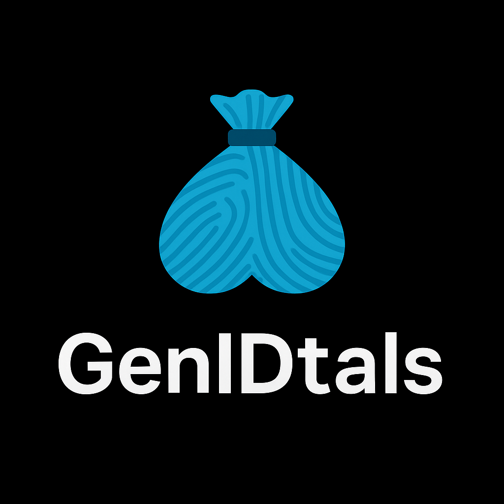

# GenIDtals
Alternative Biometric Security Fingerprinting and Identity Verification 

"Breaches are spreading faster than viruses in the ’60s—and for once, we might have the cure. Enter GenIDtals: the snug, biometric firewall cradled neatly in the palm of your hand. Not just protection—prevention. This is the foreskin of the future—non-circumventable, and definitely not something you let anyone snip. It’s the digital prophylactic we didn’t know we needed, turning hard problems into flaccid threats. Unsolicited malware? Trojans? Blocked. This isn’t security—it’s sackurity. The only cockblock I’ll proudly endorse." 

# GenIDtals™

<p align="center">
  
</p>

## Advanced Anatomical Biometric Authentication System


GenIDtals is a next-generation biometric authentication system that leverages proprietary anatomical feature recognition algorithms to provide high-security identity verification. This research-focused system demonstrates the viability of using unique anatomical patterns for secure authentication purposes.

## Overview

GenIDtals fuses four independent anatomical modalities into one verification decision:

- **Keypoint geometry**: SIFT keypoints at vessel junctions, follicles and texture corners, matched with RootSIFT, a ratio test and RANSAC geometric verification. The fitted transform also registers the probe onto the reference for the other modalities.
- **Vascular pattern mapping**: multi-scale Hessian (Frangi-style) vesselness topology.
- **Dermatoglyphic texture analysis**: Haar-wavelet band energies plus rotation-invariant LBP.
- **Follicular distribution metrics**: follicle *positions*, which stay stable when surface appearance changes.

Each capture is quality-gated, checked for liveness and normalized for pose before matching. Templates are sealed with AES-256-GCM and bound to their owner.

## Integrate Anywhere

| Stack | Integration |
|---|---|
| **Python** | Embedded SDK: `from genidtals import BiometricEngine` |
| **Any language** | REST API: `genidtals serve` or the Docker image, with an [OpenAPI spec](docs/openapi.json) for generating clients |
| **Node.js / Deno / Bun / TypeScript** | Zero-dependency client in [`clients/typescript`](clients/typescript) |
| **Python → remote service** | `genidtals.client.GenIDtalsClient` (standard library only) |
| **Your database** | Stateless templates: store the sealed blob in your own users table |
| **Your storage / KMS** | Plug in a custom `TemplateStore` or `KeyProvider` |

Full guide: **[docs/integration.md](docs/integration.md)**

## Quick Start

```bash
pip install -e .                 # SDK
pip install -e ".[server]"       # + REST server
```

### Python SDK

```python
from genidtals import BiometricEngine

engine = BiometricEngine(security_level="high")

engine.enroll_user("user_12345", ["ref1.jpg", "ref2.jpg", "ref3.jpg"])

result = engine.authenticate("user_12345", "auth_attempt.jpg")
if result.authenticated:
    print("Authentication successful")
else:
    print(result.reason, result.message)    # no_match | low_quality | liveness_failed | locked_out | ...
```

Or keep templates in your own database:

```python
template = engine.create_template("u_123", images)                # encrypted, bound to "u_123"
result = engine.verify_template("u_123", template, capture)
```

### REST API (any language)

```bash
export GENIDTALS_KEYS="$(genidtals keygen)"                # master key, from your secret manager
export GENIDTALS_API_KEYS="$(genidtals keygen --api-key)"
genidtals serve                                            # http://127.0.0.1:8080

printf '{"image": "%s"}' "$(base64 < probe.png | tr -d '\n')" |
  curl -X POST localhost:8080/v1/users/alice/verify --data-binary @- \
       -H "Authorization: Bearer $GENIDTALS_API_KEYS" -H "Content-Type: application/json"
```

```bash
docker build -t genidtals . && docker run -p 8080:8080 -e GENIDTALS_KEYS -e GENIDTALS_API_KEYS genidtals
```

### TypeScript

```ts
import { GenIDtalsClient } from "@genidtals/client";

const client = new GenIDtalsClient({ baseUrl: "https://biometrics.internal", apiKey });
await client.enroll("alice", [ref1, ref2]);
const { authenticated, reason } = await client.verify("alice", probe);
```

## Accuracy

Measured on the hard synthetic benchmark: arbitrary rotation, ±15% scale,
elastic tissue deformation, ±20% uneven lighting, partial occlusion, and
variable focus and noise. Each subject has 3 enrollment images and 3 probes.

| | v0.1 | **v0.2** |
|---|---|---|
| Equal error rate | 1.33% | **0.00%** |
| Lowest genuine score | 19.6 | **≥ 83** |
| Highest impostor score | 58.5 (overlapping) | **≤ 26** |
| Verification time | ~25 ms | ~60–110 ms |

The default thresholds sit at 40–60, well inside that gap. **Synthetic results
are not real-world results.** Run `genidtals calibrate --dataset <your
captures>` before production; it fits fusion weights and thresholds for each
security level's target false-accept rate. Details: **[docs/accuracy.md](docs/accuracy.md)**

| Security level | Target FAR | Min. enrollment images | Liveness enforced | Min. quality |
|---|---|---|---|---|
| `low` | 1e-2 | 1 | no | 30 |
| `standard` | 1e-4 | 2 | yes | 40 |
| `high` | 1e-5 | 3 | yes | 50 |
| `maximum` | 1e-6 | 4 | yes | 60 |

## Security

- **AES-256-GCM sealed templates** with per-record HKDF keys, cryptographically bound to the user or subject (tampering or swapping fails to open)
- **No raw image retention**: only encrypted feature templates are stored
- **Pseudonymous storage**: record keys are HMACs, so stores never contain user IDs
- **Key rotation** with zero downtime (`genidtals rotate-keys`), plus pluggable KMS/HSM key providers
- **Brute-force lockout** with exponential back-off, shared across processes through the store
- **Score hiding** by default, which blocks hill-climbing attacks
- **Liveness detection**: sharpness, moiré and optical-flow micro-motion
- **Hardened inputs**: decoder pixel caps, request size limits, strict store keys, no pickle
- **Mandatory API keys** on the REST server, compared in constant time
- **Privacy-safe audit events** for your SIEM

Threat model and known limitations: **[docs/security.md](docs/security.md)**

## Technical Architecture

```
            ┌──────────┐   ┌─────────┐   ┌──────────┐   ┌───────────────┐
 image ───▶ │ Decode & │──▶│ Quality │──▶│ Liveness │──▶│ Normalization │
 (+frames)  │  limits  │   │  gate   │   │  checks  │   │ (ROI + pose)  │
            └──────────┘   └─────────┘   └──────────┘   └───────┬───────┘
                                                                ▼
 ┌───────────────┐   ┌──────────────┐   ┌───────────────────────────────────┐
 │   Decision    │◀──│  Calibrated  │◀──│ Keypoints → RANSAC registration → │
 │ + lockout +   │   │ score fusion │   │ vascular · texture · follicular   │
 │    audit      │   └──────────────┘   └─────────────────┬─────────────────┘
 └───────────────┘                                        │
                                       ┌──────────────────▼──────────────────┐
                                       │ AES-256-GCM sealed templates        │
                                       │ File · SQLite · Memory · your store │
                                       └─────────────────────────────────────┘
```

## Technical Stack

- **Core**: Python 3.10+, OpenCV, NumPy, SciPy
- **Cryptography**: `cryptography` (AES-256-GCM, HKDF-SHA256, HMAC-SHA256, Argon2id)
- **Server**: FastAPI + Uvicorn (optional extra), OpenAPI 3
- **Clients**: Python (stdlib only), TypeScript (fetch, zero dependencies)
- **Testing**: pytest (106 tests; CI matrix Python 3.10–3.13), an accuracy benchmark, and a TypeScript end-to-end test against a live server

## CLI

```bash
genidtals enroll --user alice --images ref1.jpg ref2.jpg ref3.jpg
genidtals authenticate --user alice --image probe.jpg [--frames f2.jpg f3.jpg]
genidtals status | delete | unlock --user alice
genidtals quality --image probe.jpg
genidtals diagnostics                         # environment + self-test
genidtals keygen [--api-key]                  # new master key / API key
genidtals rotate-keys                         # new key + re-seal all records
genidtals benchmark [--dataset DIR]           # EER, FAR/FRR per security level
genidtals calibrate --dataset DIR --out calibration.json
genidtals serve [--host --port --docs]        # REST API
genidtals openapi --out openapi.json
genidtals synth --identity 1 --count 3 [--hard]   # synthetic test images
```

Global options: `--home` (data directory, default `~/.genidtals`), `--store`
(a directory, or a `.db` file for SQLite), `--level`, `--calibration`, `--json`.

## Project Layout

```
genidtals/
  engine.py         BiometricEngine: enrollment, verification, stateless templates, rotation
  preprocessing.py  input decoding with limits, ROI segmentation, pose normalization
  quality.py        capture quality scoring
  liveness.py       presentation-attack checks
  features/         keypoints, vascular, texture, follicular extractors
  matching.py       registration-aware matching
  calibration.py    fusion weights + FAR-based thresholds
  evaluation.py     EER / FAR / FRR measurement
  crypto.py         AES-256-GCM sealing, key providers, rotation
  stores.py         File / SQLite / Memory stores + TemplateStore interface
  security.py       lockout and audit events
  server.py         REST API      client.py   Python HTTP client
  cli.py            command line  synthetic.py  synthetic specimens
clients/typescript/ TypeScript client
docs/               integration guide, security model, accuracy, OpenAPI spec
examples/           embedded, stateless, custom store, curl
```

## Development

```bash
pip install -e ".[dev]"
pytest                     # full suite
ruff check genidtals tests examples
genidtals benchmark        # accuracy on the hard synthetic set
```

## Applications

- **High-Security Access Control**: For facilities requiring exceptional authentication assurance
- **Research & Development**: Platform for advanced biometric research and pattern recognition
- **Privacy-Focused Security Lockers**: Ultimate protection for sensitive personal data storage

## Ethics & Privacy

- All biometric data remains under user control
- Raw images are never stored; templates are encrypted at rest, bound to their owner, and erasable at any time (`delete_user`)
- Pseudonymized storage and audit logs support GDPR/CCPA obligations (compliance remains a property of each deployment)
- Transparent processing documentation

## License

This software is available for public use.

## Contact

- **Development Team**: dev@rbl.llc
---

*GenIDtals is a product of RBL LLC All rights reserved.*
*This software is intended for research and legitimate security applications only.*
